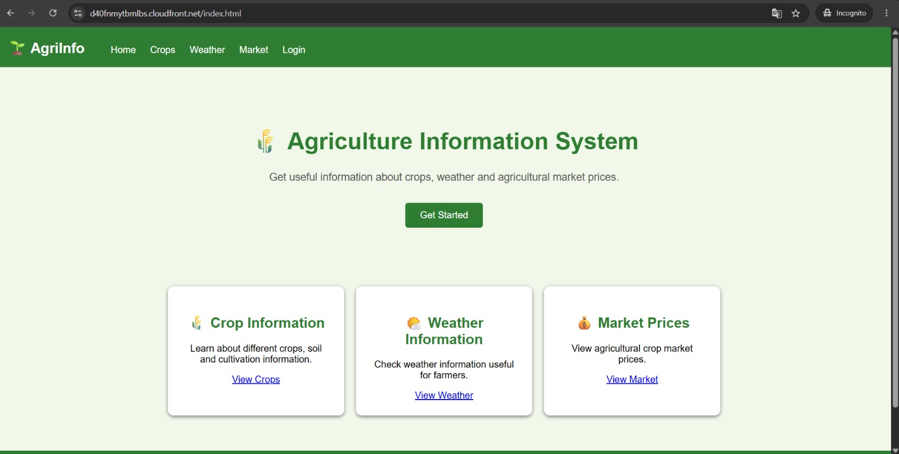

# Cloud-Based-Agriculture-Information-System
 # 1.Project Overview 

The Cloud-Based Agriculture Information System is a web-based application designed to help farmers access useful agricultural information through a centralized platform.

The system provides farmer registration and login, crop information, weather forecasts, and market price information. It uses AWS cloud services to host the frontend, process backend requests, and store application data securely.

# 2.Problem Statement 

Farmers face several challenges in accessing important agricultural information required for effective farming and decision-making. Crop details, weather information, and agricultural market prices are often available through different sources, making it difficult and time-consuming for farmers to collect the required information in one place.

Major Problems

Lack of Centralized Information: Farmers need to depend on multiple sources to obtain agricultural information.

Difficulty in Accessing Crop Details: Finding useful information about different crops and their cultivation can be challenging.

Weather Information Challenges: Farmers need timely weather information to plan their agricultural activities.

Lack of Market Price Awareness: Farmers may find it difficult to access updated agricultural market prices.

Time-Consuming Information Collection: Collecting information from different platforms requires additional time and effort.

Limited Accessibility: Farmers need a simple and user-friendly platform to access agricultural information.

# 3.Proposed System 

Our Cloud-Based Agriculture Information System addresses these challenges using AWS cloud infrastructure, including Application Load Balancing, Auto Scaling, private networking, Amazon RDS managed database services, Amazon S3 for frontend hosting, Amazon CloudFront for content delivery, and Amazon CloudWatch for infrastructure monitoring.

# 4.Architecture Diagram 

Cloud-Based Agriculture Information System follows a three-tier AWS architecture consisting of the Presentation Layer, Application Layer, and Database Layer.

## 1.Presentation Layer – Frontend 

AWS Services:

#### Amazon S3

 Amazon S3 stores the static frontend files.

#### Amazon CloudFront

 Amazon CloudFront delivers frontend content securely using HTTPS.

 Farmers access the application through the CloudFront URL.

 No custom domain name is required.

#### Technologies:

HTML

CSS

JavaScript

## 2.Application Layer – Backend 

AWS Services:

#### Amazon VPC

 Provides an isolated cloud networking environment.

#### Application Load Balancer (ALB)

 The Application Load Balancer distributes incoming API requests.

#### Amazon EC2

 Backend EC2 instances run the Flask application inside private subnets.

#### Auto Scaling Group

 Auto Scaling automatically adjusts the number of EC2 instances based on application demand.

#### Bastion Host

 Provides secure SSH access to private EC2 instances.

#### Technologies:

Python

Flask

## 3.Database Layer – Data Storage 

AWS Service:

#### Amazon RDS (MySQL)

 Stores farmer information.

 Stores crop-related information.

 Stores market-related data.

 Database access is restricted to the backend application in the private subnet.

# AWS Services Used 

| AWS Service | Purpose |
|---|---|
| Amazon CloudFront | Secure frontend content delivery |
| Amazon S3 | Static frontend hosting |
| Application Load Balancer | Distributes API requests |
| Amazon EC2 | Runs the Flask backend |
| Auto Scaling Group | Automatically scales backend EC2 instances |
| Amazon RDS (MySQL) | Managed relational database |
| Bastion Host | Secure SSH access to private resources |
| Amazon CloudWatch | Monitors application health and logs |
| Amazon VPC | Provides isolated cloud networking |
| NAT Gateway | Allows private subnet resources to access the internet securely without direct inbound access |

# Major Problems Faced During Implementation

## 1.VPC Configuration Issues 

#### Problem

 Faced difficulties configuring the VPC network, including public and private subnets, route tables, and internet connectivity. Private EC2 instances were not accessible initially due to incorrect network routing and security configurations.

#### Troubleshooting 

 - Checked VPC CIDR block and subnet configurations.

 - Verified public and private subnet route table associations.

 - Checked Internet Gateway and NAT Gateway configurations.

 - Verified Security Group inbound and outbound rules.

 - Tested connectivity between the Bastion Host and private EC2 instances.

#### Resolution
 - Corrected route table configurations and subnet associations.

 - Configured the Internet Gateway for public subnet connectivity.

 - Configured the NAT Gateway for private subnet outbound internet access.

 - Updated Security Group rules to allow SSH access from the Bastion Host to private EC2 instances.

 - Verified connectivity after applying the changes.

#### Access Flow

 Local Machine (Admin) | Bastion Host (Public Subnet) | Private EC2 Instance (Private Subnet) | Flask Backend Application

 - The private EC2 instance was accessed through the Bastion Host using its private IP address over SSH.

 - This approach allowed secure administrative access without exposing backend EC2 instances directly to the internet.

#### Key Finding

 A Bastion Host acts as a secure entry point for accessing and managing EC2 instances deployed inside private subnets.

## 2.EC2 Connectivity Issues: 

#### Problem

 Faced challenges accessing private EC2 instances through the Bastion Host due to SSH configuration and Security Group issues.

#### Troubleshooting

 - Verified the SSH private key file, checked the private EC2 instance's private IP address, and inspected SSH connection settings. Also examined Security Group inbound rules to identify why the Bastion Host could not connect to the private instance.

#### Resolution

 - Corrected SSH configuration, ensured the correct private key was used, and updated Security Group rules to allow SSH traffic (Port 22) from the Bastion Host Security Group. Successfully established SSH connectivity to the private EC2 instance.

#### Access Flow

 Local Machine (Admin) | Bastion Host (Public Subnet) | Private EC2 Instance (Private Subnet)

 - The private EC2 instance was accessed through the Bastion Host using its private IP address over SSH.

#### Key Finding:

 A Bastion Host provides a secure entry point for accessing private EC2 instances without exposing them directly to the internet

## 3.Load Balancer Configuration Issues

#### Problem

 Experienced target group health check failures and ALB connectivity problems while connecting the backend EC2 instance.

#### Troubleshooting

 - Checked the Target Group health status to identify unhealthy backend EC2 instances.

 - Verified the health check path, protocol, and port configuration.

 - Confirmed that the Flask application was running on port 5000.

 - Inspected EC2 and ALB Security Group inbound rules.

 - Tested backend connectivity and checked HTTP response status.

#### Resolution
 
 - Configured the correct health check path (/) in the Target Group.

 - Verified that the Flask application returned HTTP 200 successfully.

 - Updated the backend EC2 Security Group to allow port 5000 traffic from the ALB Security Group.

 - Ensured the ALB listener forwarded requests to the correct Target Group.

 - Rechecked the Target Group and confirmed that the backend EC2 instance became healthy.

#### Workflow:

 Local Machine / Farmer | Amazon CloudFront | Application Load Balancer | Target Group | Private EC2 Instance (Flask Backend)

 - The ALB receives incoming requests and forwards them to the registered healthy EC2 instances through the Target Group.

 - The Flask backend processes the requests and returns responses to the users.

Key Finding

 An Application Load Balancer distributes incoming requests to healthy backend instances and improves application availability.

 ## 4.Backend Deployment :

 #### Problem

  Experienced difficulties deploying and running the Flask application on the EC2 instance.

#### Troubleshooting
 - Checked the Flask application files and dependencies.

 - Verified Python and Flask installation on EC2.

 - Checked whether the application was running on the correct port (5000).

 - Tested backend connectivity using local curl commands.

 - Verified EC2 security group inbound rules.

#### Resolution

 - Installed the required Python dependencies using requirements.txt.

 - Corrected Flask application configuration.

 - Configured Flask to listen on 0.0.0.0:5000.

 - Started the Flask backend application on EC2.

 - Verified backend connectivity through the Application Load Balancer.

 ## Key Findings:

 - Understood how to deploy Flask applications on EC2.

 - Learned the importance of port configuration and security groups.

 - Understood backend connectivity with an Application Load Balancer.

 - Gained practical experience in troubleshooting deployment issues.

## 5.CloudFront Integration Issues:

#### Problem

 Faced difficulties connecting the CloudFront-hosted frontend with the Flask backend API due to incorrect API endpoint URLs and connectivity issues.

#### Troubleshooting

 - Checked CloudFront distribution and origin configurations.

 - Verified frontend API endpoint URLs and ALB DNS name.

 - Inspected browser console errors and network request failures.

 - Checked HTTP/HTTPS protocol mismatches and Mixed Content errors.

 - Verified backend API responses and Flask application connectivity.

#### Resolution

 - Corrected API endpoint URLs to point to the appropriate backend endpoint.

 - Configured the ALB as the API origin in CloudFront.

 - Resolved HTTPS and HTTP Mixed Content issues.

 - Verified ALB listener and backend EC2 connectivity.

 - Tested registration and login API requests through the CloudFront URL.

#### Workflow

 Farmer / Web Browser | Amazon CloudFront | Amazon S3 (Frontend) | Application Load Balancer (API Requests) | Private EC2 Instance (Flask Backend)

#### Key Finding

 - Amazon CloudFront securely delivers frontend content, while the Application Load Balancer routes API requests to the backend application.

! [Login-page](images/Login-page.jpeg)

